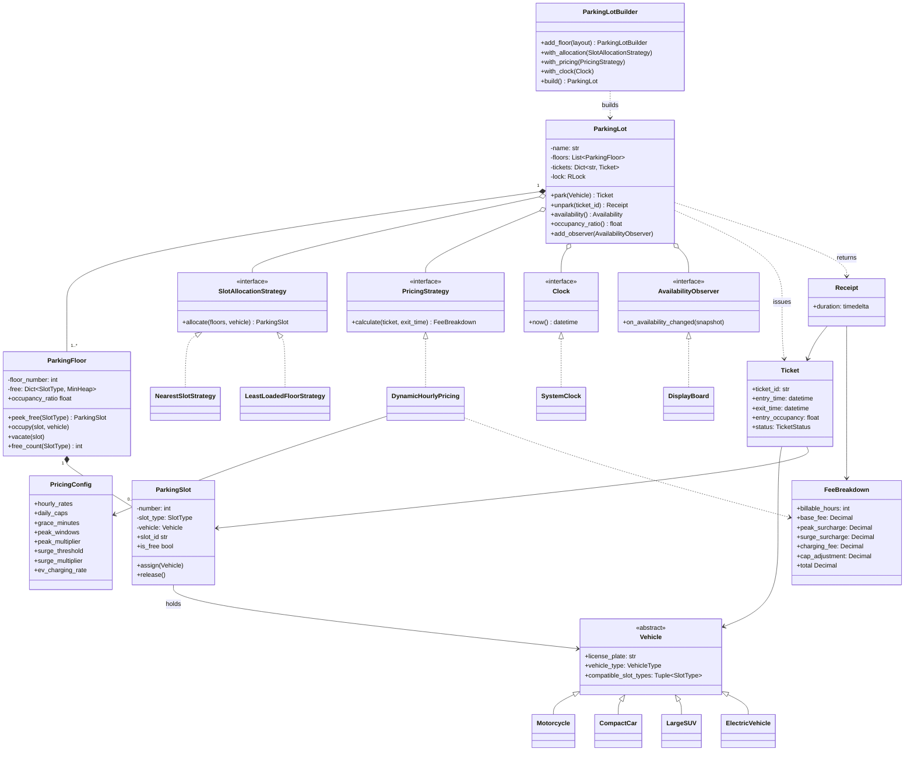
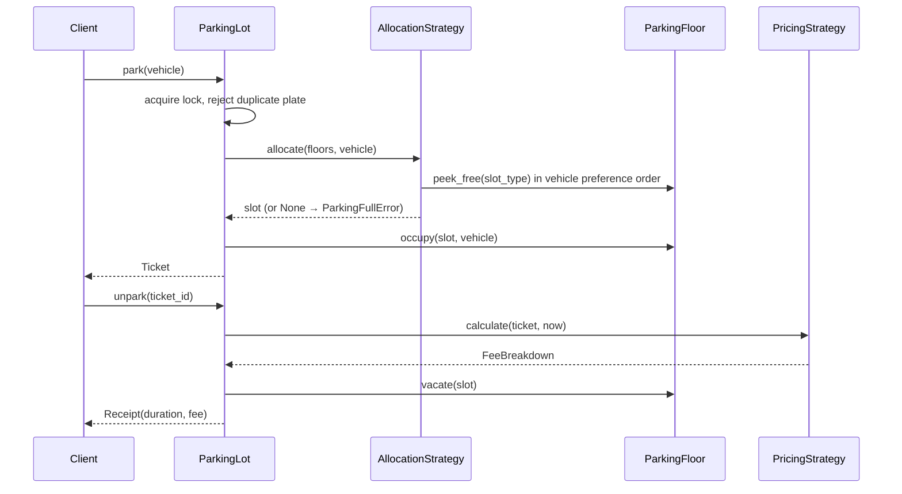

# Smart Parking Lot: Low-Level Design

Multi-floor parking lot supporting **Motorcycles, Compact Cars, Large SUVs and Electric Vehicles**, with automated slot allocation, ticketing and dynamic hourly pricing.

```
python demo.py                                   # end-to-end walkthrough
python -m unittest discover -s tests -t . -v     # 24 tests
```
Python 3.10+, standard library only.

## 1. Requirements

| Functional | Non-functional |
|---|---|
| Park a vehicle → allocate slot → issue ticket | Thread-safe (no double allocation) |
| Unpark with ticket → compute fee → free slot | O(1) slot lookup, O(log n) update |
| 4 vehicle types, 4 slot types, N floors | New vehicle / pricing / allocation rule = new class, no edits to the core |
| Best-fit fallback (e.g. bike → compact slot if bike slots full) | Deterministic tests (injected clock, `Decimal` money) |
| Dynamic pricing: grace, peak, surge, EV charging, daily cap | |
| Live availability board | |

## 2. UML class diagram



### Sequence: park → unpark



## 3. Design decisions

| Pattern / principle | Where | Why |
|---|---|---|
| **Strategy** | `SlotAllocationStrategy`, `PricingStrategy` | Swap algorithms at construction time without touching `ParkingLot`. |
| **Template data on the type** | `Vehicle.compatible_slot_types` | Fallback order lives with the vehicle, so allocation code has no `if vehicle is X` chains (OCP). |
| **Builder** | `ParkingLotBuilder` | Readable construction of multi-floor lots. |
| **Observer** | `AvailabilityObserver` / `DisplayBoard` | Entrance boards update without polling. Notified *outside* the lock to avoid deadlocks. |
| **Facade** | `ParkingLot` | Single thread-safe entry point; floors/slots never mutated by clients. |
| **Dependency injection** | `Clock`, strategies | Deterministic tests. |
| **Value objects** | `Ticket`, `Receipt`, `FeeBreakdown` | Itemised, auditable bills. |

### Allocation algorithm
1. Walk `vehicle.compatible_slot_types` from best fit to worst fit (smallest suitable slot first).
2. For each type, the strategy picks a floor: `NearestSlotStrategy` takes the lowest floor, `LeastLoadedFloorStrategy` takes the lowest occupancy ratio.
3. Each floor keeps a **min-heap of free slots per type**, so `peek` is O(1) and `occupy`/`vacate` are O(log n). Freed low-numbered slots are reused first.

| Vehicle | Slot preference |
|---|---|
| Motorcycle | Motorcycle → Compact → Large |
| Compact car | Compact → Large |
| Large SUV | Large only |
| Electric | EV-charging → Compact → Large |

### Pricing algorithm
```
minutes  = ceil(duration in minutes)
if minutes <= 15: fee = 0                                  # grace period
hours    = ceil(minutes / 60)
base     = rate[type] * hours
peak     = rate * 0.5 * (# hour-blocks starting in 08-10 or 17-20)
surge    = (base + peak) * 0.25   if lot occupancy at entry >= 80%
parking  = min(base + peak + surge, daily_cap[type] * ceil(hours / 24))
charging = 30 * hours             if parked in an EV-charging bay
total    = parking + charging
```
Default rates (₹/h): Motorcycle 20, Compact 40, SUV 60, EV 50. Every number is configurable in `PricingConfig`.

### Concurrency
A single `RLock` guards allocation, occupancy, and ticket maps, making `park`/`unpark` atomic. `test_no_double_allocation_under_contention` runs 60 threads against 20 slots and asserts exactly 20 successes with unique slots. For a distributed deployment, replace the lock with per-floor locks or a DB row-lock on the slot.

### Edge cases handled
Duplicate plate entry, double or unknown ticket exit, lot full for one vehicle class while others still have space, exit-before-entry timestamps, plate normalisation, 24h+ stays (cap scales per day), fee computed *before* any state change so a pricing failure cannot corrupt the lot.

## 4. Test coverage (24 tests)

| Area | Cases |
|---|---|
| Allocation | fallback chains, SUV strictness, EV bay preference/fallback, cars never take EV bays, nearest vs least-loaded, slot reuse |
| Lifecycle | duplicates, invalid/double unpark, re-entry, observers/display board, receipt |
| Pricing | grace boundary, 60 vs 61 min, per-type rates, peak blocks, surge, EV charging, daily cap (12h, 25h), custom config, negative duration |
| Concurrency | 60 threads / 20 slots |

## 5. Extension points
* **New vehicle** (e.g. Truck): subclass `Vehicle`, add a `SlotType`, add a rate to `PricingConfig`.
* **New pricing** (monthly pass, validation discounts): implement `PricingStrategy`, or wrap `DynamicHourlyPricing` as a decorator.
* **Payments / gates / persistence**: add a `PaymentProcessor` consumed by `unpark`, entry and exit `Gate` classes, and a `TicketRepository` in place of the in-memory dicts.

## 6. Layout
```
smart_parking/
  enums.py  exceptions.py  clock.py
  vehicles.py     # Vehicle hierarchy
  slots.py        # ParkingSlot, ParkingFloor
  allocation.py   # allocation strategies
  pricing.py      # PricingConfig, DynamicHourlyPricing, FeeBreakdown
  ticket.py       # Ticket, Receipt
  parking_lot.py  # ParkingLot, DisplayBoard, ParkingLotBuilder
tests/test_parking_lot.py
demo.py
```
