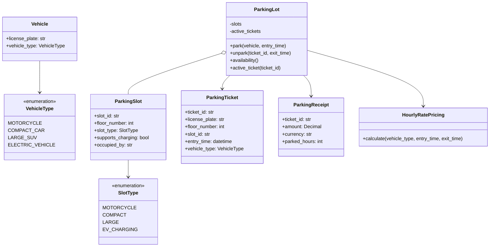

# UML Class Diagram

## Allocation policy

- Motorcycle: motorcycle, compact, or large slots.
- Compact car: compact or large slots.
- Large SUV: large slots only.
- Electric vehicle: charging slots first, then large slots.
- Pick the lowest floor and slot ID among compatible slots.
- Charge at least one hour and round partial hours up.
- Apply the configured multiplier for weekend exits.
